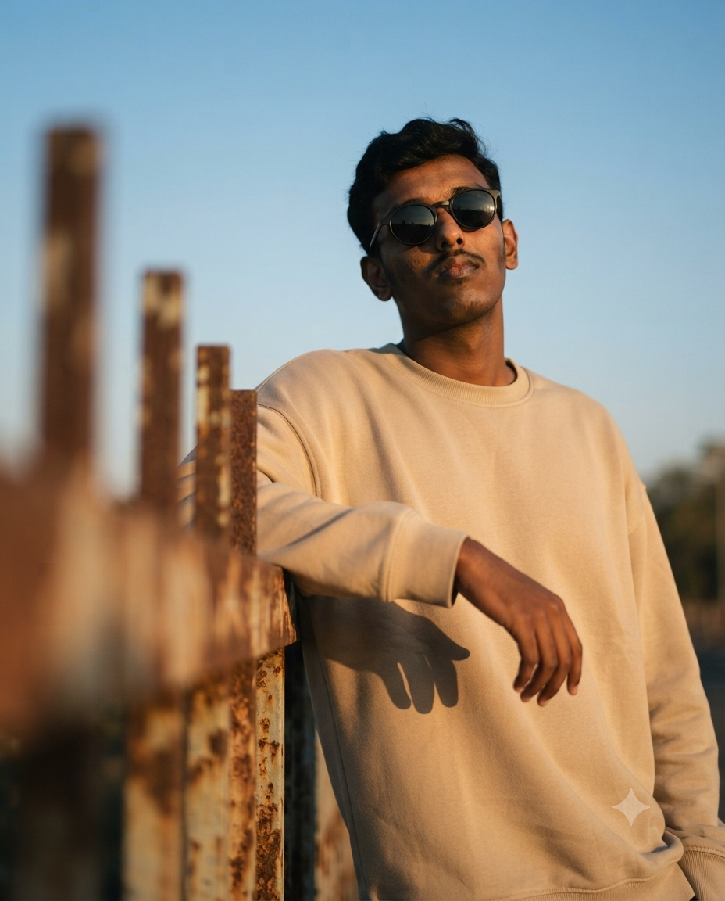
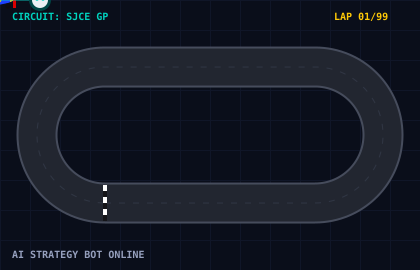

<!-- ══════════════════════════════════════════════════════════════ -->
<!--                    ANIMATED HEADER BANNER                     -->
<!-- ══════════════════════════════════════════════════════════════ -->

<div align="center">

  

  <br/><br/>

  <!-- TYPEWRITER (ASCII-safe for GitHub Camo proxy) -->
  <a href="https://github.com/veeda241">
    
<!--                    ANIMATED HEADER BANNER                     -->
<!-- ══════════════════════════════════════════════════════════════ -->

<div align="center">

  

  <!-- TYPEWRITER -->
  <a href="https://github.com/veeda241">
    
  </a>

  <br/><br/>

  <!-- Row 1: F1 Pit-Wall Telemetry Status Badges -->
  <p align="center">
    &nbsp;
    &nbsp;
    &nbsp;
    
  </p>

  <!-- Row 2: Live GitHub Telemetry & Social Links -->
  <p align="center">
    <a href="https://github.com/veeda241">
      
    </a>&nbsp;
    <a href="https://github.com/veeda241?tab=followers">
      
    </a>&nbsp;
    <a href="https://github.com/veeda241?tab=repositories">
      
    </a>&nbsp;
    <a href="https://www.linkedin.com/in/vyas-s-veeda/">
      
    </a>&nbsp;
    <a href="https://veeda241.github.io/portfolio/">
      
    </a>
  </p>

  <br/>

  

</div>

---

<!-- ══════════════════════════════════════════════════════════════ -->
<!--                        ABOUT ME                               -->
<!-- ══════════════════════════════════════════════════════════════ -->

<table>
<tr>
<td width="62%" valign="top">

## 🧠 I'm Vyas: AI Engineer & Builder

**Third-year B.Tech (AI & ML), 2024–2028** @ **St. Joseph's College of Engineering**, Chennai 🇮🇳

I am a passionate AI engineer with hands-on experience building intelligent systems and automating data workflows. My work sits at the intersection of **research-grade AI** and **production-ready engineering**, from emotionally-aware multimodal agents to real-time computer vision proctoring tools.

**Core Focus Areas:**
- 🤖 **LLM Engineering**: RAG pipelines, prompt engineering, agent orchestration
- 🧬 **Multimodal AI**: vision + audio + language fusion systems
- 👁️ **Computer Vision**: YOLOv8, MediaPipe, gaze tracking
- 🌐 **AI Backends & APIs**: FastAPI + vector DBs + RAG services
- 🗄️ **Database Engineering**: Oracle SQL, PostgreSQL, MongoDB, Supabase
- 🏎️ Huge fan of **Red Bull Racing**, because strategy is everything

> *"I can architect a distributed AI backend at 2AM and deliver a killer demo at 8AM."*

</td>
<td width="38%" align="center" valign="middle">



</td>
</tr>
</table>

<br/>

<div align="center">
  
</div>

---

<!-- ══════════════════════════════════════════════════════════════ -->
<!--                         PROJECTS                              -->
<!-- ══════════════════════════════════════════════════════════════ -->

## 🚀 Flagship AI Projects

<div align="center">

<table>
<tr>
  <td align="center" width="50%">

  ### 🧬 [Multimodal Emotion-Aware Agent](https://github.com/veeda241?tab=repositories)
  **Behavior-Change Research & Multimodal Fusion**

  Fuses text, speech, and video emotion signals before LLM response generation. Fine-tuned **RoBERTa-base** on GoEmotions (28 labels; `0.44` test macro-F1), an **emotion2vec** head on RAVDESS (6 classes; `92.7%` test accuracy), and a hybrid **CNN-ViT** video model feeding a Multimodal Fusion Network.

  **Key features:** Text + audio + video fusion · Fine-tuned RoBERTa & emotion2vec · CNN-ViT encoder · Gradio demo

  
  
  
  
  

  </td>
  <td align="center" width="50%">

  ### 🏎️ [Tessellate AI](https://github.com/veeda241?tab=repositories)
  **Counterfactual F1 Pit-Stop Decision Evaluator**

  Scores the same race snapshot twice—toggling only the pit decision—to recommend the option with the better projected finish. Trained a **CatBoost** regressor with leave-circuit-out **GroupKFold** (`2.02` RMSE, `1.48` MAE vs. `2.46` baseline — **~18% lower**) with `5–15 ms` **FastAPI** inference.

  **Key features:** Counterfactual simulation · Leave-circuit-out GroupKFold · Sub-15ms inference · Pydantic schemas

  
  
  
  
  

  </td>
</tr>
<tr>
  <td align="center" width="50%">

  ### 🔥 [Nova AI](https://github.com/veeda241/Nova-AI)
  **Multimodal Emotional Intelligence System**

  Combines facial expression recognition (Vision Encoder), vocal tone analysis (Audio Encoder), and text into a unified emotional context vector. A specialized SLM layer generates session-level psychological well-being reports with stress profiling and suggested interventions.

  **Key features:** Multimodal fusion · SLM psychological engine · Living memory · Adaptive UI · Privacy-first local storage

  
  
  
  
  
  

  </td>
  <td align="center" width="50%">

  ### 🛡️ [ExamGuard Pro](https://github.com/veeda241/ExamGuard-Pro)
  **AI-Powered Real-Time Exam Proctoring**

  Multi-modal proctoring with MediaPipe face detection, gaze vector tracking, YOLOv8 unauthorized device detection, and Tesseract OCR for forbidden-content screening. Dynamic weighted risk scoring (`Safe` / `Review` / `Suspicious`) with a WebSocket live dashboard and automated PDF violation reports.

  **Key features:** 4-layer cheat-resistance · Chrome Manifest V3 extension · JWT multi-agent pipeline · Real-time Supabase DB

  
  
  
  
  
  

  </td>
</tr>
</table>

</div>

<div align="center">
  
</div>

### 🏁 More from the Garage

| Project | Sector | What it does |
| :--- | :--- | :--- |
| **[StudyBuddy Pro](https://github.com/veeda241/StudyBuddyPro)** | EdTech / RAG | Adaptive offline-capable AI learning suite with local NLP quizzes, spaced repetition, and gamified Pomodoro |
| **NEXUS** | Multimodal RAG | Dual DB engine combining ChromaDB vector search, NetworkX knowledge graph, and Groq → Gemini → Ollama fallback |
| **EMORA / Stress-Aware HAPA** | Research | On-device multimodal stress index with HAPA stage routing |
| **movie-AI** | Generative Video | Veo/Sora-style video generation: VAE + DiT training pipeline |
| **Bharat Krishi Anuman** | AgriTech | Smart India Hackathon AI pipeline for agricultural forecasting and automation |
| **Wayne AI** | Systems / Agents | Custom background AI assistant daemon |
| **ProMatch** | Full-Stack | Swipe-based professional mentorship matching platform |

<div align="center">
<br/>

[](https://github.com/veeda241?tab=repositories)

</div>

---

<!-- ══════════════════════════════════════════════════════════════ -->
<!--                    ENGINEERING PHILOSOPHY                     -->
<!-- ══════════════════════════════════════════════════════════════ -->

## ⚡ Pit-Wall Engineering Philosophy

<table>
<tr>
<td width="50%" valign="top">

**🎯 Validation Over Guesswork**

No data leakage, no inflated benchmarks. Models undergo strict `GroupKFold` splits, macro-F1 / RMSE telemetry, and baseline ablations before deployment.

</td>
<td width="50%" valign="top">

**🛡️ Fail-Safe by Design**

APIs rate-limit in live demos. I build deterministic guardrails, offline NLP engines, and multi-provider fallbacks (`Groq → Gemini → Ollama`).

</td>
</tr>
<tr>
<td width="50%" valign="top">

**⚡ Sub-Second Latency Focus**

From `5–15 ms` counterfactual inference to real-time webcam gaze tracking, models are quantized and served asynchronously via **FastAPI**.

</td>
<td width="50%" valign="top">

**🏁 24-Hour Hackathon Velocity**

From blank repository to working LLM agent, vector store, frontend UI, and pitch deck under clock pressure—with zero boilerplate bloat.

</td>
</tr>
</table>

<br/>

<details>
<summary><b>📄 View Developer Manifest (<code>vyas.config.yaml</code>)</b></summary>
<br/>

```yaml
# ── vyas.config.yaml ──────────────────────────────────────────────────────────
identity:
  name      : "Vyas S"
  role      : "AI Engineer"
  degree    : "B.Tech — Artificial Intelligence & Machine Learning"
  college   : "St. Joseph's College of Engineering, Chennai"
  batch     : "2024 – 2028"
  year      : 3
  cgpa      : 7.51
  location  : "Chennai, India 🇮🇳"
  status    : "🟢 Open to Internships & AI Collabs"

current_internship:
  company   : "Stackrack Tech India Pvt Ltd"
  role      : "React & AI Developer Support Intern"
  period    : "Dec 2025 – Present"

past_internships:
  - company : "IQmath Technologies"
    role    : "AI Engineer Intern"
    mode    : "Hybrid"
    period  : "Jun 2026 – Jul 2026"
    focus   : ["Generative AI", "ML pipelines", "Real-world AI application development"]
  - company : "Inspire Softech"
    role    : "Artificial Intelligence Intern"
    period  : "Jun 2025 – Jul 2025"

ai_stack:
  llm_frameworks : ["LangChain", "LlamaIndex", "OpenAI API", "Anthropic Claude", "Google Gemini"]
  ml_libraries   : ["PyTorch", "TensorFlow", "Keras", "scikit-learn", "CatBoost"]
  vision         : ["YOLOv8", "OpenCV", "MediaPipe"]
  vector_dbs     : ["Pinecone", "ChromaDB", "FAISS", "MongoDB Vector Search"]
  deployment     : ["FastAPI", "Docker (basic)", "Vercel", "Render", "GitHub Pages"]

flagship_projects:
  - name    : "Multimodal Emotion-Aware Conversational Agent"
    desc    : "RoBERTa-base (0.44 macro-F1) + emotion2vec (92.7% acc) + CNN-ViT multimodal fusion network"
    stack   : ["PyTorch", "Hugging Face", "Gradio"]
    status  : "🟢 Active"
  - name    : "Tessellate AI"
    desc    : "Counterfactual F1 pit-stop evaluator — CatBoost + leave-circuit-out GroupKFold (2.02 RMSE, 5–15 ms FastAPI)"
    stack   : ["Python", "CatBoost", "FastAPI", "Pydantic"]
    status  : "🟢 Active"
  - name    : "Nova AI"
    desc    : "Multimodal Emotional AI — vision encoder + audio encoder + text fusion, SLM psychological analysis"
    stack   : ["Python", "FastAPI", "React 19", "TensorFlow", "LangChain", "Google Gemini"]
    status  : "🟢 Active"
  - name    : "ExamGuard Pro"
    desc    : "Real-time AI proctoring — YOLOv8, MediaPipe, Tesseract OCR, dynamic risk scoring, Chrome Extension"
    stack   : ["Python", "FastAPI", "React 19", "YOLOv8", "Supabase"]
    status  : "🟢 Active"

community:
  - "GDG Chennai — Member"
  - "GDG on Campus SJCE — Member"
  - "CodeHack Pirates — Community Lead"
  - "Data Analytics Club — Communications"

currently_learning:
  - "Agentic AI workflows (AutoGen, CrewAI)"
  - "Retrieval-Augmented Generation (RAG) fine-tuning"
  - "Multimodal LLMs (vision + language)"
  - "Efficient inference & model quantization"

fun_fact: >
  I once shipped a working LLM agent, a REST API backend, a Next.js frontend,
  AND a pitch deck — all in a single 24hr hackathon. Red Bull was involved. 🎤
# ──────────────────────────────────────────────────────────────────────────────+Emotionally-Aware+Multimodal+AI;Shipping+AI+Prototypes+in+24+Hours;Making+Machines+Understand+Humans" alt="Typing SVG" />
  </a>

  <br/><br/>

  <!-- Row 1: F1 Pit-Wall Telemetry Status Badges -->
  <p align="center">
    
    
    
    
  </p>

  <!-- Row 2: Live GitHub Telemetry & Social Links -->
  <p align="center">
    <a href="https://github.com/veeda241?tab=followers">
      
    </a>
    <a href="https://github.com/veeda241?tab=repositories">
      
    </a>
    <a href="https://www.linkedin.com/in/vyas-s-veeda/">
      
    </a>
    <a href="https://veeda241.github.io/portfolio/">
      
    </a>
  </p>

  <br/>

  

</div>

---

<!-- ══════════════════════════════════════════════════════════════ -->
<!--                        ABOUT ME                               -->
<!-- ══════════════════════════════════════════════════════════════ -->

## 🧠 About Me

<table>
<tr>
<td width="60%" valign="top">

**Vyas S** — **3rd-Year B.Tech (AI & ML), 2024–2028**  
📍 *St. Joseph's College of Engineering, Chennai 🇮🇳*

I build intelligent systems at the intersection of **research-grade AI** and **production-ready engineering**—spanning emotionally-aware multimodal agents, counterfactual telemetry models, and real-time computer vision pipelines.

**Core Focus Areas**
- 🤖 **LLM Engineering:** RAG pipelines, prompt engineering, multi-agent orchestration
- 🧬 **Multimodal AI:** Vision + audio + language fusion architectures
- 👁️ **Computer Vision:** YOLOv8, MediaPipe, real-time gaze tracking
- 🌐 **AI Backends & APIs:** FastAPI, vector databases, asynchronous inference
- 🗄️ **Database Engineering:** PostgreSQL, Oracle SQL, MongoDB, Supabase
- 🏎️ **F1 Strategy:** Die-hard **Red Bull Racing** fan—because telemetry wins races

> *"I can architect a distributed AI backend at 2 AM and deliver a live demo at 8 AM."*

</td>
<td width="40%" align="center" valign="middle">


</td>
</tr>
</table>

<div align="center">
  
</div>

---

<!-- ══════════════════════════════════════════════════════════════ -->
<!--                     FLAGSHIP PROJECTS                         -->
<!-- ══════════════════════════════════════════════════════════════ -->

## 🚀 Flagship AI Projects

<table>
<tr>
<td width="50%" valign="top">

### 🧬 [Multimodal Emotion-Aware Agent](https://github.com/veeda241?tab=repositories)
*Behavior-Change Research & Multimodal Fusion*

Fuses text, speech, and video emotion signals prior to LLM response generation.
- **Text:** Fine-tuned **RoBERTa-base** on GoEmotions (28 labels; `0.44` test macro-F1)
- **Audio:** **emotion2vec** head on RAVDESS (6 classes; `92.7%` test accuracy)
- **Vision & Demo:** Hybrid **CNN-ViT** video encoder feeding a Multimodal Fusion Network with a Gradio UI

<p>
  
  
  
  
  
</p>

</td>
<td width="50%" valign="top">

### 🏎️ [Tessellate AI](https://github.com/veeda241?tab=repositories)
*Counterfactual F1 Pit-Stop Decision Evaluator*

Scores identical race snapshots twice—toggling only the pit decision—to recommend the higher-finishing strategy.
- **Validation:** **CatBoost** regressor evaluated via leave-circuit-out **GroupKFold**
- **Performance:** `2.02` RMSE / `1.48` MAE vs. `2.46` baseline (**~18% error reduction**)
- **Serving:** Sub-15 ms (`5–15 ms`) **FastAPI** inference with strict Pydantic schemas

<p>
  
  
  
  
  
</p>

</td>
</tr>
<tr>
<td width="50%" valign="top">

### 🔥 [Nova AI](https://github.com/veeda241/Nova-AI)
*Multimodal Emotional Intelligence System*

Synthesizes facial expressions, vocal tone, and text into a unified emotional context vector.
- **Engine:** Specialized SLM layer generating session-level stress profiles and interventions
- **Architecture:** Persistent living memory, adaptive UI, and privacy-first local storage

<p>
  
  
  
  
  
  
</p>

</td>
<td width="50%" valign="top">

### 🛡️ [ExamGuard Pro](https://github.com/veeda241/ExamGuard-Pro)
*AI-Powered Real-Time Exam Proctoring*

4-layer cheat-resistant proctoring combining **MediaPipe** gaze tracking, **YOLOv8** device detection, and **Tesseract OCR**.
- **Risk Engine:** Dynamic weighted scoring (`Safe` / `Review` / `Suspicious`) with WebSocket telemetry
- **Stack:** Chrome Manifest V3 extension, JWT multi-agent pipeline, Supabase, and automated PDF reports

<p>
  
  
  
  
  
  
</p>

</td>
</tr>
</table>

### 🏁 More from the Garage

| Project | Domain | Summary |
| :--- | :--- | :--- |
| **[StudyBuddy Pro](https://github.com/veeda241/StudyBuddyPro)** | EdTech / Offline AI | Adaptive learning suite with local NLP quizzes, spaced repetition, and gamified Pomodoro |
| **NEXUS** | GraphRAG | Multimodal RAG combining ChromaDB vector search, NetworkX knowledge graphs, and `Groq → Gemini → Ollama` fallback |
| **EMORA / Stress-Aware HAPA** | AI Research | On-device multimodal stress index paired with Health Action Process Approach (HAPA) stage routing |
| **movie-AI** | Generative Video | Veo/Sora-inspired video generation pipeline built on VAE + Diffusion Transformer (DiT) |
| **Bharat Krishi Anuman** | AgriTech | Smart India Hackathon AI pipeline for agricultural forecasting and automation |
| **Wayne AI** | Systems / Agents | Custom background AI assistant daemon |
| **ProMatch** | Full-Stack | Swipe-based professional mentorship matching platform |

<div align="center">
  <br/>
  <a href="https://github.com/veeda241?tab=repositories">
    
  </a>
</div>

---

<!-- ══════════════════════════════════════════════════════════════ -->
<!--                    ENGINEERING PHILOSOPHY                     -->
<!-- ══════════════════════════════════════════════════════════════ -->

## ⚡ Pit-Wall Engineering Philosophy

<table>
<tr>
<td width="50%" valign="top">

**🎯 Validation Over Guesswork**  
No data leakage, no inflated benchmarks. Models undergo strict `GroupKFold` splits, macro-F1 / RMSE telemetry, and baseline ablations before deployment.

</td>
<td width="50%" valign="top">

**🛡️ Fail-Safe by Design**  
APIs rate-limit in live demos. I build deterministic guardrails, offline NLP engines, and multi-provider fallbacks (`Groq → Gemini → Ollama`).

</td>
</tr>
<tr>
<td width="50%" valign="top">

**⚡ Sub-Second Latency Focus**  
From `5–15 ms` counterfactual inference to real-time webcam gaze tracking, models are quantized and served asynchronously via **FastAPI**.

</td>
<td width="50%" valign="top">

**🏁 24-Hour Hackathon Velocity**  
From blank repository to working LLM agent, vector store, frontend UI, and pitch deck under clock pressure—with zero boilerplate bloat.

</td>
</tr>
</table>

<br/>

<details>
<summary><b>📄 View Developer Manifest (<code>vyas.config.yaml</code>)</b></summary>
<br/>

```yaml
# ── vyas.config.yaml ──────────────────────────────────────────────────────────
identity:
  name: "Vyas S"
  role: "AI Engineer"
  degree: "B.Tech — Artificial Intelligence & Machine Learning"
  college: "St. Joseph's College of Engineering, Chennai"
  batch: "2024 – 2028"
  year: 3
  cgpa: 7.51
  location: "Chennai, India 🇮🇳"
  status: "🟢 Open to Internships & AI Collabs"

current_internship:
  company: "Stackrack Tech India Pvt Ltd"
  role: "React & AI Developer Support Intern"
  period: "Dec 2025 – Present"

past_internships:
  - company: "IQmath Technologies"
    role: "AI Engineer Intern"
    mode: "Hybrid"
    period: "Jun 2026 – Jul 2026"
    focus: ["Generative AI", "ML pipelines", "Real-world AI application development"]
  - company: "Inspire Softech"
    role: "Artificial Intelligence Intern"
    period: "Jun 2025 – Jul 2025"

ai_stack:
  llm_frameworks: ["LangChain", "LlamaIndex", "OpenAI API", "Anthropic Claude", "Google Gemini"]
  ml_libraries: ["PyTorch", "TensorFlow", "Keras", "scikit-learn", "CatBoost"]
  vision: ["YOLOv8", "OpenCV", "MediaPipe"]
  vector_dbs: ["Pinecone", "ChromaDB", "FAISS", "MongoDB Vector Search"]
  deployment: ["FastAPI", "Docker (basic)", "Vercel", "Render", "GitHub Pages"]

flagship_projects:
  - name: "Multimodal Emotion-Aware Conversational Agent"
    desc: "RoBERTa-base (0.44 macro-F1) + emotion2vec (92.7% acc) + CNN-ViT multimodal fusion network"
    stack: ["PyTorch", "Hugging Face", "Gradio"]
    status: "🟢 Active"
  - name: "Tessellate AI"
    desc: "Counterfactual F1 pit-stop evaluator — CatBoost + leave-circuit-out GroupKFold (2.02 RMSE, 5–15 ms FastAPI)"
    stack: ["Python", "CatBoost", "FastAPI", "Pydantic"]
    status: "🟢 Active"
  - name: "Nova AI"
    desc: "Multimodal Emotional AI — vision encoder + audio encoder + text fusion, SLM psychological analysis"
    stack: ["Python", "FastAPI", "React 19", "TensorFlow", "LangChain", "Google Gemini"]
    status: "🟢 Active"
  - name: "ExamGuard Pro"
    desc: "Real-time AI proctoring — YOLOv8, MediaPipe, Tesseract OCR, dynamic risk scoring, Chrome Extension"
    stack: ["Python", "FastAPI", "React 19", "YOLOv8", "Supabase"]
    status: "🟢 Active"

community:
  - "GDG Chennai — Member"
  - "GDG on Campus SJCE — Member"
  - "CodeHack Pirates — Community Lead"
  - "Data Analytics Club — Communications"

currently_learning:
  - "Agentic AI workflows (AutoGen, CrewAI)"
  - "Retrieval-Augmented Generation (RAG) fine-tuning"
  - "Multimodal LLMs (vision + language)"
  - "Efficient inference & model quantization"

fun_fact: >
  I once shipped a working LLM agent, a REST API backend, a Next.js frontend,
  AND a pitch deck — all in a single 24hr hackathon. Red Bull was involved. 🏎️
# ──────────────────────────────────────────────────────────────────────────────
