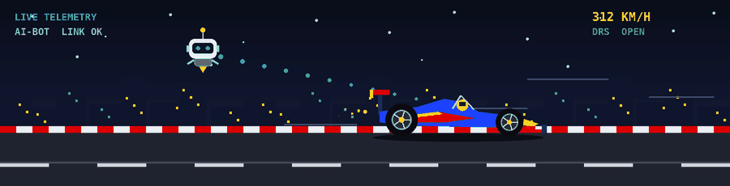
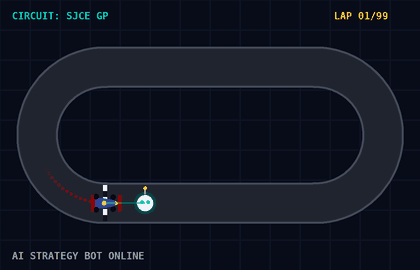

<!-- ══════════ HEADER ══════════ -->

  

  

    

  
  
  
  

   

  
  
  
  
  

    
  

---

### 🏎️ Race Control Overview

  

 

> *"Rigorous validation in the telemetry—grouped cross-validation, multimodal fusion, and low-latency inference."*

Third-year **B.Tech AI & ML** undergraduate (**'28**) at **St. Joseph's College of Engineering, Chennai** and **React & AI Developer Support Intern** at **Stackrack Tech** (previously **AI Engineer Intern** at **IQmath Technologies**). I train and evaluate deep learning, multimodal, and agentic RAG systems with strict validation (**GroupKFold**, **macro-F1**, **RMSE**), and lead developer workshops with **CodeHack Pirates** and **GDG Chennai / GDG on Campus SJCE**.

---

### 🛠️ Pit Wall Tech Stack

| Sector | Technologies |
| :--- | :--- |
| **ML & Deep Learning** | `PyTorch` `TensorFlow` `Keras` `scikit-learn` `CatBoost` `Hugging Face` `YOLOv8` `MediaPipe` |
| **LLMs & Agentic AI** | `LangChain` `LlamaIndex` `OpenAI API` `Anthropic Claude` `Google Gemini` `RAG` `Multimodal Fusion` |
| **Data, Eval & Vector DBs** | `pandas` `NumPy` `GroupKFold` `Pinecone` `ChromaDB` `FAISS` `MongoDB Vector Search` |
| **Backend & Deployment** | `Python` `SQL` `TypeScript` `JavaScript` `FastAPI` `Flask` `Node.js` `React` `PostgreSQL` `Supabase` `Docker` |

---

### 🏆 Featured Telemetry (Projects)

  

 

| Chassis / Project | Sector Focus | Engineering Telemetry |
| :--- | :--- | :--- |
| **[`Tessellate AI`](https://github.com/veeda241)** | **Counterfactual F1 Strategy** | Scores identical race snapshots twice (pit vs. stay out) using a **CatBoost** regressor validated via leave-circuit-out **GroupKFold** (`2.02 RMSE`, `1.48 MAE` — **18% lower** than naive baseline) with `5–15 ms` **FastAPI** inference. |
| **[`Multimodal Emotion Agent`](https://github.com/veeda241)** | **Multimodal Fusion & LLMs** | Fuses text (**RoBERTa-base** on GoEmotions, `0.44 macro-F1`), speech (**emotion2vec** on RAVDESS, `92.7% accuracy`), and video (**CNN-ViT**) signals into a Multimodal Fusion Network for behavior-change support. |
| **[`ExamGuard Pro`](https://github.com/veeda241)** | **Real-Time CV & Agents** | Live proctoring combining **MediaPipe** gaze/face tracking, **YOLOv8** device detection, and OCR with weighted risk scoring behind a **FastAPI** WebSocket dashboard (`Supabase` `Chrome Extension`). |
| **[`Nova AI`](https://github.com/veeda241)** | **Affective Computing & SLMs** | Combines facial expression, vocal tone, and text into a unified emotional context vector paired with an SLM layer for session-level well-being reports (`React 19` `FastAPI` `LangChain` `Gemini`). |

---

### 📊 Season Telemetry

  
  

